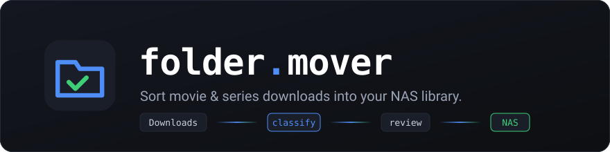
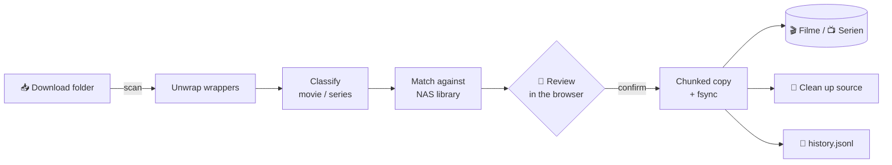

<p align="center">
  
</p>

<p align="center">
  <a href="https://github.com/simuuh/folder-mover/actions/workflows/ci.yml"></a>
  
  
  <a href="https://github.com/astral-sh/ruff"></a>
  <a href="LICENSE"></a>
  <br>
  
  <a href="https://github.com/simuuh/folder-mover/pkgs/container/folder-mover"></a>
  
  
  <a href="https://github.com/simuuh/folder-mover/commits/main"></a>
</p>

<p align="center">
  <b>A tiny self-hosted web UI that turns a messy download folder into a clean movie & series library on your NAS —<br>without the complexity of the *arr stack.</b>
</p>

---

You download with JDownloader (or anything else) into a local folder. Folder Mover
scans it, peels away UUID and hoster wrapper folders, recognises movies, episodes and
season packs, matches them against the series that already exist on your NAS — and
moves everything into place after **you** confirmed it. With a live progress bar.

## ✨ Highlights

| | |
|---|---|
| 🧠 **Smart classification** | `S01E01`, `S01` season packs, `1x01`, `Folge 01`, movies by year + quality tags |
| 🪆 **Wrapper unwrapping** | UUID folders, hoster suffixes (`- rapidgator`), double-nested release folders — **also wrappers inside wrappers** and wrappers holding several releases |
| 📚 **Library matching** | Matches against existing NAS series folders (ignoring case, punctuation, articles, years and accents), so `The.Boys.S05` lands in your existing `The Boys (2019)/` — similar names are only suggested |
| 🔁 **Duplicate detection** | Finds an older release of the same movie (title + year, also `Title (Year)` folders) and offers to replace it — the old one is deleted only after the new one arrived |
| ⏳ **Unfinished downloads** | Releases with `.part` / `.crdownload` files are flagged and deselected |
| ⚡ **Instant moves** | Same filesystem? Then it's a rename, not a copy |
| 🐳 **Docker or bare metal** | Multi-arch image (amd64/arm64) or a systemd service |
| 📈 **Live progress** | Chunked copy with speed, ETA and per-file progress via Server-Sent Events; reconnects after a page reload |
| 🛡️ **Safe by default** | Nothing moves without confirmation; free-space check; no half-copied files left behind; all paths validated server-side |
| 🗂️ **History** | Searchable log of every move, filterable by type and errors |
| 🌗 **Dark & light** | Follows your OS theme, switchable in the header |

## ⚙️ How it works



### Folder structures it understands

```text
Downloads/
├── 6d5b82f9-…/                                       UUID wrapper → looked through
│   └── Movie.2022.German.1080p.WEB-Group/
│       └── movie.mkv
├── 0a1b2c3d-…/                                       wrapper inside a wrapper
│   └── Series.S05.German.1080p.WEB-Group - rapidgator/
│       └── Series.S05.German.1080p.WEB-Group/
│           ├── series.s05e01.mkv
│           └── series.s05e02.mkv
├── 9f8e7d6c-…/                                       one wrapper, two releases → two entries
│   ├── Movie.A.2020.German.1080p.WEB-Group/
│   └── Movie.B.2021.German.1080p.WEB-Group/
└── The.Sheriff.2026.German.1080p.WEB-SiXTYNiNE/
    └── The.Sheriff.2026.German.1080p.WEB-SiXTYNiNE.mkv
```

Result on the NAS:

```text
/mnt/Filme/M/Movie.2022.German.1080p.WEB-Group/
/mnt/Filme/S/The.Sheriff.2026.German.1080p.WEB-SiXTYNiNE/    (leading articles are ignored)
/mnt/Serien/Series Name/S05/series.s05e01.mkv
```

<details>
<summary><b>Wrapper rules in detail</b></summary>

A top-level entry is resolved recursively (up to 6 levels) into **zero or more releases**:

1. A folder that directly contains video files is a release — unless it is a UUID /
   configured wrapper, in which case each video file becomes its own entry.
2. A folder with exactly one sub-folder is looked through if it is a wrapper
   (UUID, short generic name, `wrapper_patterns`), if the child is a UUID, or if the
   names match (`Release - hoster` › `Release`).
3. A wrapper with several sub-folders is split into one entry per sub-folder that
   contains videos. A real release with sub-folders (season pack with per-episode
   folders, `Sample/`, `Subs/`) is kept whole.

When a wrapper holds several releases, deleting or moving one of them never touches
its siblings.
</details>

## 🚀 Quick start

### 🐳 Docker (recommended for Synology, Unraid, TrueNAS …)

```bash
mkdir folder-mover && cd folder-mover
curl -O https://raw.githubusercontent.com/simuuh/folder-mover/main/docker-compose.yml
curl -o .env https://raw.githubusercontent.com/simuuh/folder-mover/main/.env.example
nano .env                      # host paths, PUID/PGID, password
docker compose up -d
```

Open `http://<host>:8080`. All settings live in `.env` — the compose file stays untouched,
so updating is just `docker compose pull && docker compose up -d`.

- **`PUID` / `PGID`** must be the uid/gid that owns your downloads and media (`id <user>` on the host).
  The container fixes the owner of the config folder itself and then runs as that user.
- **Hashed password:** `docker run --rm -it ghcr.io/simuuh/folder-mover python app.py --hash-password`
  and paste the result into `.env` as `FOLDER_MOVER_PASSWORD_HASH='…'` — keep the **single quotes**,
  the hash contains `$`.
- Inside the container the paths are fixed: `/downloads`, `/movies`, `/series` and `/config`
  (history, session secret and an optional `config.yaml`).

<details>
<summary><b>⚡ Instant moves instead of copying</b></summary>

If downloads and media live on the **same filesystem**, Folder Mover simply renames
instead of copying — done in milliseconds. Docker treats separate bind mounts as
separate filesystems, so mount a common parent once and point the paths into it:

```yaml
# docker-compose.override.yml (next to docker-compose.yml)
services:
  folder-mover:
    environment:
      FOLDER_MOVER_DOWNLOAD_DIR: /data/downloads
      FOLDER_MOVER_MOVIES_DIR:   /data/media/Filme
      FOLDER_MOVER_SERIES_DIR:   /data/media/Serien
    volumes:
      - /volume1/data:/data
```
</details>

### 🐧 Bare metal (systemd)

**Requirements:** Linux with systemd, Python 3.11+, NAS mounted as a local path (SMB/NFS).

```bash
git clone https://github.com/simuuh/folder-mover.git
cd folder-mover

cp config.yaml.example config.yaml
nano config.yaml                    # paths, user, password

sudo bash install.sh                # or: sudo SERVICE_USER=media bash install.sh
```

The service runs on `http://<host>:8080` (gunicorn, one worker) and starts on boot.

```bash
journalctl -u folder-mover -f       # logs
sudo systemctl restart folder-mover # after config changes
```

### Set a hashed password

```bash
/opt/folder-mover/venv/bin/python /opt/folder-mover/app.py --hash-password
```

Paste the output into `auth.password_hash` and remove the plaintext `password`.

## 🔧 Configuration

All keys are optional; defaults live in [`config.py`](config.py).

| Key | Default | Description |
|---|---|---|
| `download_dir` | `/home/user/Downloads` | Folder that gets scanned |
| `movies_dir` | `/mnt/Filme` | Movies end up in `movies_dir/<Letter>/<Release>` |
| `series_dir` | `/mnt/Serien` | Episodes end up in `series_dir/<Series>/Sxx/` |
| `host` / `port` | `0.0.0.0` / `8080` | Listen address |
| `secret_key` | generated | Session secret; if empty, one is created once in `.secret_key` next to the history |
| `session_days` | `30` | Logins expire after this many days (and immediately on logout or a password change) |
| `proxy_count` | `0` | Number of reverse proxies in front of the app — set it so the login lockout sees the real client IP |
| `auth.username` | `admin` | Login name |
| `auth.password_hash` | – | Hash from `app.py --hash-password` (preferred) |
| `auth.password` | – | Plaintext fallback if no hash is set. Login stays disabled while neither is set — the old default `changeme` is refused |
| `video_extensions` | `.mkv .mp4 .avi .m4v .ts .m2ts` | What counts as a video |
| `wrapper_patterns` | `[]` | Extra regexes for container folders that are never a release |
| `mount_marker` | – | File/folder that must exist in `movies_dir` **and** `series_dir` before anything is moved (e.g. `.folder-mover`) — protects against filling the empty mountpoint of an unmounted share |

**Environment variables** override `config.yaml`:

| Variable | Overrides |
|---|---|
| `FOLDER_MOVER_DOWNLOAD_DIR` / `_MOVIES_DIR` / `_SERIES_DIR` | the three directories |
| `FOLDER_MOVER_USERNAME` / `_PASSWORD` / `_PASSWORD_HASH` | `auth.*` |
| `FOLDER_MOVER_SECRET_KEY`, `FOLDER_MOVER_HOST`, `FOLDER_MOVER_PORT` | the matching keys |
| `FOLDER_MOVER_LANGUAGE`, `FOLDER_MOVER_MOUNT_MARKER` | the matching keys |
| `FOLDER_MOVER_SESSION_DAYS`, `FOLDER_MOVER_PROXY_COUNT` | the matching keys |
| `FOLDER_MOVER_CONFIG` | path of the config file |
| `FOLDER_MOVER_HISTORY` | path of `history.jsonl` (the session secret is stored next to it) |

## 🌍 Languages

The UI is available in **German** and **English** (switch in the header, or set
`language` / `FOLDER_MOVER_LANGUAGE`; `auto` follows the browser).

Translations are plain JSON files in [`translations/`](translations) — German
(`de.json`) is the source, every other file only needs the same keys:

```json
"scan.found":     "{count} entries found",
"scan.found_one": "{count} entry found"
```

- Keep `{placeholders}` exactly as in `de.json`; `_one` variants are used when `count` is 1.
- Missing or empty entries fall back to German.
- **New language:** copy `de.json` to e.g. `fr.json`, translate, restart — it shows up in the
  language switch automatically. `pytest tests/test_i18n.py` checks keys and placeholders.

## 🔒 Security

Folder Mover is built for a **single user on a LAN or VPN** — do not expose it to the
internet. It validates every path server-side, rate-limits logins and sends strict
security headers. See [SECURITY.md](SECURITY.md) for details and how to report issues.

## 🧑‍💻 Development

```bash
python3 -m venv venv && source venv/bin/activate
pip install -r requirements-dev.txt
cp config.yaml.example config.yaml   # point the paths at test folders
python app.py                        # dev server on :8080

pytest                               # tests
ruff check .                         # lint
```

The frontend is plain HTML/CSS/JS in [`templates/`](templates) and [`static/`](static) — no build step.

## 🗺️ Roadmap

- [ ] Jellyfin / Plex library refresh after a move
- [ ] Notifications (ntfy, Gotify, Telegram) when downloads are waiting or a move finished
- [ ] Auto-scan / watch mode for the download folder
- [ ] Cancel a running move
- [ ] TMDB lookup for clean `Title (Year)` folder names
- [ ] Optional episode renaming & folder-per-movie for loose files

## 📄 License

[MIT](LICENSE) © Simon Muster
